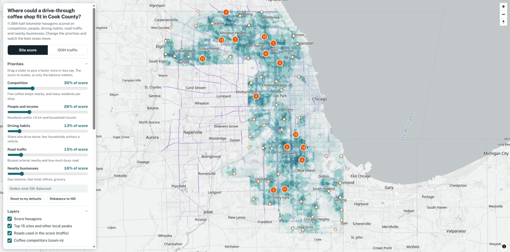
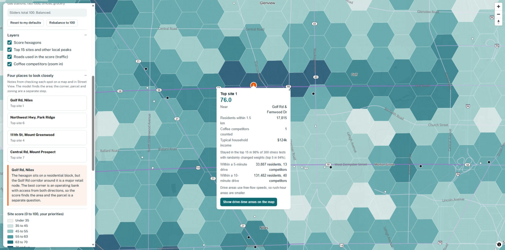
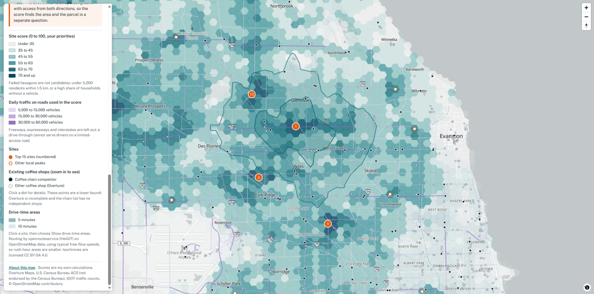
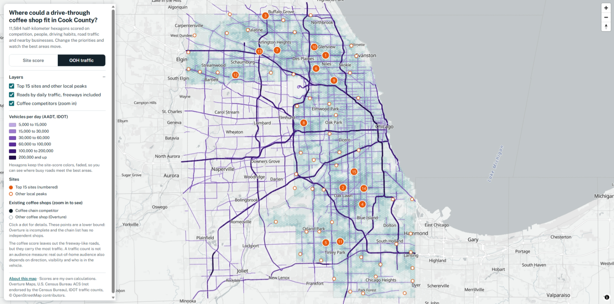
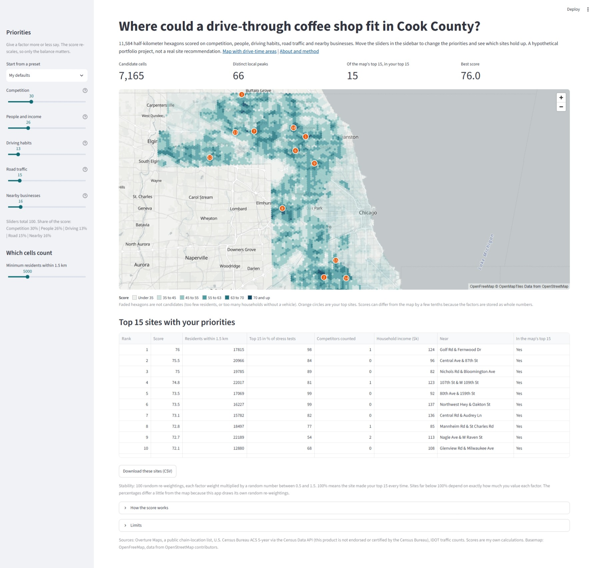

# Where could a drive-through coffee shop fit in Cook County?

A site-selection map for a hypothetical drive-through coffee shop in Cook County, Illinois: 11,584 half-kilometer hexagons scored on competition, people, driving habits, road traffic and nearby businesses, with live priority sliders and on-demand drive-time areas. It is a demonstration of a spatial analysis workflow, not a real site recommendation.

**Live map:** [burlesongis.github.io/cook-county-coffee/web](https://burlesongis.github.io/cook-county-coffee/web/) &nbsp;|&nbsp; **Interactive app (Streamlit):** [cook-county-coffee.streamlit.app](https://cook-county-coffee.streamlit.app/) &nbsp;|&nbsp; **Method and limits:** `web/about.html`


*Hexagons colored by site score, with the top 15 sites numbered and existing coffee shops shown when zoomed in.*

## The Question

Where in Cook County is there plenty of demand (many nearby residents, good incomes, people who drive) but not yet much coffee competition, and how much does that answer depend on my own judgment calls?

This is a personal portfolio project built to show how I use spatial tools on a marketing-and-media style question: take open data, build a transparent score, stress-test it, and put it in front of people in a way they can explore. The views and any mistakes are mine alone.

## Key Findings

- **The model finds gaps in competition, not the biggest crowds.** Removing the competition terms changes all 15 top sites, and so does a demand-only version. The places that rank well have many residents and few counted coffee shops nearby.
- **There is a stable core and a soft edge.** I rescored every cell 300 times with each weight randomly scaled between 0.5 and 1.5. Six of the top 15 sites stayed in the top 15 in at least 90% of runs, and the leading site stayed in the top 5 in 94% of them. Five sites (ranks 9, 12, 13, 14 and 15) made the top 15 in under 60% of runs, so I treat them as "worth a look", not "top picks".
- **Counting traffic matters.** Dropping the road-traffic terms keeps only 4 of the 15 sites, and doubling the competition weights keeps 10. The weights are judgment calls, which is why the map has sliders.
- **A 1.5 km radius and a 10-minute drive area tell different stories.** They agree fairly well on how many people are nearby (rank correlation 0.80) but poorly on residents per competitor (0.29). Only 4 of the top 15 stay in the top 15 when sites are ranked by residents per competitor inside the 10-minute drive area, versus 8 on the radius. The radius shows the local gap; the drive area shows the size of the wider market and how contested it is.
- **Cook-only data undercounted trade areas near the county line, and fixing it changed the numbers more than the ranking.** In my first version, 20 of the 58 local peaks had under 90% of their 10-minute drive area inside Cook County, so residents and shops outside the line were not counted. After adding the neighboring counties, 14 of the top 15 sites were unchanged (score correlation 0.98), but 10-minute populations rose by 15% to 170% at the 15 most affected border sites.

## Data Sources

| Dataset | Source | Used for |
|---|---|---|
| Places (coffee shops, gas stations, fast food, offices, grocery) | [Overture Maps Foundation](https://overturemaps.org/), Places theme, read with DuckDB | Competitors and nearby businesses |
| Chain coffee locations | Store locations for Starbucks, Dunkin', Dutch Bros and 7 Brew, collected from each brand's public store locator in June 2026 (4 chains, no independent shops) | Competitors, matched to Overture within 100 m so no shop is counted twice |
| Population, income, commuting, vehicles | U.S. Census Bureau ACS 5-year estimates, block groups, through the Census Data API | Residents, income, drive-alone share, households without a vehicle |
| Block-group boundaries | U.S. Census Bureau cartographic boundary files (2024, 1:500,000) | Spreading estimates onto hexagons |
| Road traffic (AADT) | Illinois Department of Transportation, public ArcGIS REST service (2025 layer) | Road-traffic factors and the OOH view |
| Drive-time areas | [openrouteservice](https://openrouteservice.org/) (HeiGIT) on OpenStreetMap data | 5- and 10-minute drive areas |
| Basemap | OpenFreeMap, data from OpenStreetMap contributors | Background map |

Data area: Cook County plus DuPage, Lake, Kane, McHenry and Will counties in Illinois and Lake County, Indiana. Only Cook County hexagons are scored.

**Attribution and terms.** Overture Maps data is used under its theme licenses. Derived values are my own calculations. This product uses the Census Bureau Data API but is not endorsed or certified by the Census Bureau. Drive-time areas are © openrouteservice by HeiGIT | Data from OpenStreetMap, and the isochrone polygons are licensed CC BY-SA 4.0; they are kept as a separate layer on the map. Names, addresses and brands of individual shops are deliberately left out of the public map: shops appear only as "Coffee chain competitor" or "Other coffee (Overture)".

## Methods

1. **Data acquisition.** DuckDB reads Overture places straight from S3 into GeoParquet. Census data comes through the Census Data API with the key kept in an environment variable. Traffic counts are pulled page by page from IDOT's public ArcGIS REST service.
2. **Grid and counts (PostGIS).** Everything is projected to NAD83 / UTM 16N (EPSG:26916) so distances and areas are in meters. A 500 m hexagon grid covers the county. For each hexagon center I count competitors and nearby businesses within 1.5 km, and spread block-group population, income and commuting to the hexagons by overlapping area. Hexagons near the county line use a ring of extra cells outside Cook so their 1.5 km neighborhood is complete.
3. **Score.** Twelve factors are each converted to a percent rank across all cells, weighted, and averaged into a 0 to 100 score: competition (fewer is better), residents per competitor, population, income, drive-alone commuting, households without a vehicle (fewer is better), busiest nearby arterial, length of busy arterial, and counts of gas stations, fast food, offices and grocery stores. Freeways are left out of the score because a drive-through cannot serve a limited-access road. Cells need at least 5,000 residents within 1.5 km and no more than 15% of households without a vehicle to be eligible.
4. **Distinct sites.** Sites are local peaks: eligible cells that score higher than every other eligible cell within 3 km. That gives 66 peaks; the top 15 are numbered.
5. **Stress test.** Weights are randomized 300 times, and four named scenarios (no competition, demand only, no traffic, double competition) are run. Each baseline site gets a "stays in the top 15" percentage shown on the map.
6. **Drive-time areas.** For every local peak, openrouteservice returns 5- and 10-minute drive areas at typical free-flow speeds. Residents and competitors inside each area are counted in PostGIS (block-group population shared by overlapping area), and sites are re-ranked on residents per competitor.
7. **Web map.** Layers are exported to GeoJSON, tiled with tippecanoe into one PMTiles file, and drawn by MapLibre GL JS from a static host. The sliders recompute scores in the browser from the factors stored on each hexagon. An "OOH traffic" view switches the roads to a daily-traffic view that includes freeways.

**Tools used:** DuckDB, GeoParquet, PostGIS (Docker), GDAL `ogr2ogr`, tippecanoe, PMTiles, MapLibre GL JS, openrouteservice, GitHub Pages. Streamlit and pydeck for the interactive app; a GeoPandas analysis notebook is planned. No server is needed for the map.

## What the Map Shows


*Zoomed in on top site 1 (Golf Rd, Niles): the popup shows its score, residents, competition, how often it stayed in the top 15 across 300 weight tests, and its 5- and 10-minute drive-area totals.*


*The 5- and 10-minute drive areas for the same site follow the road network, not a circle. They answer a different question from the 1.5 km radius used in the score: how large and how contested the wider market is.*



### Interactive app

A Streamlit app lets you move the priority sliders, change which cells count as candidates, and run a stress test showing how often each site stays in the top 15.


*The OOH traffic view: roads colored by daily vehicles (IDOT), freeways included, with the sites and coffee shops still shown. A traffic count is not an audience measure.*

- **Site score view:** score hexagons (faded where a cell is not a candidate), the top 15 sites and other local peaks, existing coffee shops when zoomed in, and the road traffic used in the score. Click a site for its score, nearby residents and competition, how stable it is under the weight tests, and a button that draws its 5- and 10-minute drive areas.
- **OOH traffic view:** roads colored by daily vehicles including freeways, with sites and coffee shops still shown. A traffic count is not an audience measure; real out-of-home audience also depends on direction, visibility and who is in the vehicle.
- **Priority sliders:** five groups (competition, people and income, driving habits, road traffic, nearby businesses) that you can re-weight and watch the best areas move.
- **Four places to look closely:** notes from checking a few sites on a map and in Street View. The model finds the area; the corner, parcel and zoning are a separate question.

## How to Run

The full pipeline needs Docker (PostGIS), GDAL, Python, DuckDB and, for tiles, tippecanoe (in WSL on Windows). In outline, from this folder:

```bash
# 1. Pull data (set CENSUS_API_KEY and ORS_API_KEY in your environment first; never put keys in files)
python pull/pull_cook_places.py       # Overture places, Cook County
python pull/pull_places_buffered.py   # Overture places including a buffer around the county
python pull/pull_census_cook.py       # ACS for Cook County
python pull/pull_census_neighbors.py  # ACS for the neighboring counties
python pull/pull_aadt_cook.py         # IDOT traffic counts

# 2. Load and score in PostGIS (run sql/01 to sql/21 in order; see the header of each script)
psql -h localhost -p 5435 -U gis -d gis -f sql/17_wide_inputs.sql
psql -h localhost -p 5435 -U gis -d gis -f sql/18_scores_v6.sql
psql -h localhost -p 5435 -U gis -d gis -f sql/19_weight_sensitivity_v6.sql
psql -h localhost -p 5435 -U gis -d gis -f sql/20_map_layers_v6.sql
python fetch_isochrones.py            # drive-time areas
psql -h localhost -p 5435 -U gis -d gis -f sql/21_isochrones_v6.sql

# 3. Export and tile
./export_geojson.ps1
bash create_pmtiles.sh

# 4. View the map (a server that supports HTTP Range requests is required for PMTiles)
cd web
python -m RangeHTTPServer 8090
```

```bash
# 5. Run the Streamlit app (from this folder, so the theme in .streamlit/ is used)
pip install -r app/requirements.txt
streamlit run app/app.py
```

The published map needs only the contents of `web/`. The app needs only `app/` and `.streamlit/`.

The competitor chain list (collected from each brand's public store locator, June 2026) is published as `data/chain_locations_public.csv` (brand, latitude, longitude only; no addresses or store numbers). Load it with the `ogr2ogr` command at the top of `sql/09_chain_validation.sql` before running `sql/13` and later; those scripts count its stores as competition.

## Project Structure

```
cook-county-coffee/
├── README.md
├── sql/                     numbered PostGIS scripts (grid, demographics, scores, sensitivity, map layers, drive times)
├── data/chain_locations_public.csv   competitor chains: brand, lat, lon only
├── pull/                    data pull scripts (Overture, Census ACS, IDOT traffic, boundaries)
├── app/                     Streamlit app (app.py, requirements.txt, data/ with hex and site CSVs)
├── .streamlit/config.toml   app theme
├── prepare_app_data.py      builds the app's CSVs from the map exports
├── load_wide_inputs.ps1     loads the neighboring-county inputs into PostGIS
├── fetch_isochrones.py      drive-time areas from openrouteservice
├── export_geojson.ps1       PostGIS tables to GeoJSON
├── create_pmtiles.sh        GeoJSON to one PMTiles file
├── web/
│   ├── index.html           the MapLibre map
│   ├── about.html           method, data sources and limits
│   ├── cook_coffee.pmtiles  vector tiles
│   └── isochrones.geojson   drive-time areas (CC BY-SA 4.0)
└── images/
    ├── map_screenshot.png   whole-county hero view
    ├── map_site_popup.png   a site popup
    ├── map_drive_time.png   5- and 10-minute drive areas
    ├── map_ooh.png          OOH traffic view
    └── streamlit_app.png    Streamlit app (full page)
```

## Limits

- **Competition is a lower bound.** Overture is incomplete, and the chain list covers four chains and no independent shops. Real competition is higher, and unevenly so.
- **Traffic counts are not audiences.** AADT is a vehicle count. It comes from Illinois only, so sites near the Indiana line can look quieter than they are.
- **The data area has an edge.** Counties beyond those listed above (for example Kenosha County, Wisconsin) are not in the data, and Overture points beyond a 0.25 degree buffer around the county are ignored.
- **Drive-time areas use free-flow speeds**, so real rush-hour areas are smaller. Sites 13, 20 and 40 are flagged on the map because their 5-minute areas are unusually small (an expressway, rail line or water boxes them in, or the router started on a poorly connected road).
- **Census figures are block-group estimates** spread to hexagons, so small differences between neighboring cells are not meaningful.
- **No site-level reality.** Parcels, zoning, lot access, turning movements, rent and permitting are not in the data. The top sites are places worth a visit, not places to build.
- **Format-neutral demand.** The score measures demand and competition. Whether the format is a drive-through lane, a walk-up window or mobile-order pickup changes what a parcel needs, not how much demand there is.
- **Billboards are not on the map.** There is no good public dataset of out-of-home inventory, and operator inventory is licensed. The same grid could score OOH faces from a client's own inventory, but that is outside this public project.

## What I Learned

- **Check how much of each trade area is inside your data.** My first version used Cook County data only. The 1.5 km score held up when I widened it, but drive-time totals near the county line were badly undercounted, and I would not have known without measuring how much of each drive area fell inside the data. Next time I will pull the surrounding counties up front, or buffer the study area by a drive time beyond the boundary.
- **Two ways of drawing a trade area answer two questions.** The radius found the local competitive gap; the drive area measured the wider market. Their rankings agreed on population but not on residents per competitor, so I show both and do not treat one as a check on the other.
- **Check where the router starts.** The router snaps each start point to the nearest road. On a ramp or frontage road the drive area comes out wrong: one site went from 287 to over 30,000 residents within 5 minutes when I restarted it from the nearest arterial. I flag low-confidence sites instead of hiding them.
- **Weights are judgment calls, so test them.** 300 random re-weightings and four named scenarios showed a stable core and a soft edge that a single ranked list would hide, and they are why the map has sliders and a stability percentage.
- **Licenses and terms are part of a public project.** Drive-time results are CC BY-SA 4.0 with required attribution, so they live in their own labeled layer. Keys stay in environment variables, and no shop names or addresses are published.
- **DIY versus commercial tools.** Commercial platforms such as Placer.ai (measured foot traffic and visitor origins from mobile location data) and CoStar (property, lease and parcel data) answer questions this project cannot: how many people actually visit a place, where they come from, and what is available to lease. What a DIY pipeline gives instead is transparency (every weight and assumption can be inspected and changed), reproducibility, no per-seat cost, and the ability to combine any open data with a client's own. For a first screen of where to look, a DIY model is a reasonable start; for a decision to commit money to a site, I would use one to narrow the field and the commercial data to verify it.

---

*Built as the capstone for Matt Forrest's Modern GIS Accelerator.*
